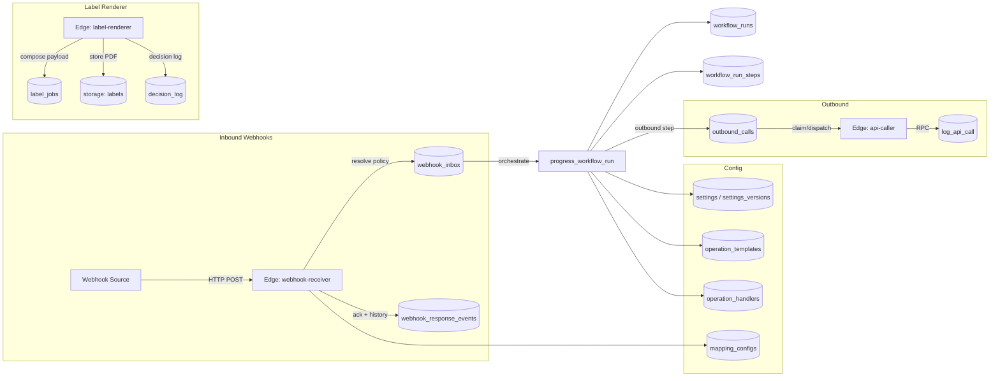

# Architecture Overview

Key principles:

- Simple: Single outbound queue, handler registry, DB-orchestrated workflows.
- Scalable: Hash + range partitions; queue + lease model; controlled cron.
- Dynamic: All behavior via settings, templates, mappings, and handler registry - zero hardcoding.
- Secure: RLS on multi-tenant and system tables; edge uses SECURITY DEFINER RPCs; storage buckets private.

## Engine-First Triggers

- **Inbound**: `webhook_inbox` rows always start workflows (intake template) before any other mutation.
- **Internal**: `domain_events` ledger captures shipment actions, address updates, and other system triggers. `run_domain_events_worker()` consults `domain_event_policy` settings and starts the configured workflow template.
- **Completion**: Workflow status transitions update `domain_events` and emit `decision_log` entries automatically.

The live tables-only dataflows reflecting this pattern are kept in:

- `docs/product/diagrams/subsystems-tables-engine-first.mmd`
- `docs/product/diagrams/subsystems-consult-tables.mmd`
- `docs/product/diagrams/subsystems-tables-strict.mmd`

These diagrams map triggers -> workflow engine -> decision_log using the exact table names, ensuring every subsystem demonstrably follows the engine-first, decision-first contract.

Implementation playbook:
- See `docs/product/guides/subsystem-implementation.md` for a step-by-step guide to add new subsystems under the engine + decision ledger contract.

